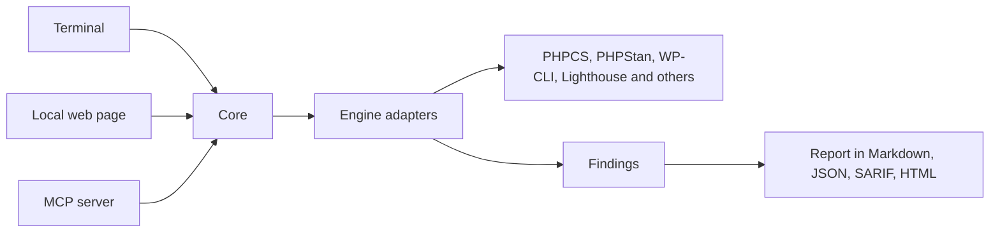

# Architecture

This document describes the design. The core, the report writers, sixteen engines, the presets and all three ways in exist: the `run` command, the local web page and the MCP server. The engines for a site URL are not built. The version is below 1.0, so the command line and the report format may still change between minor versions.

## Principles

1. wp-shakedown runs existing tools and merges what they report. PHPCS, PHPStan and WP-CLI already do their jobs well, so it adds a check of its own only where no maintained tool exists.
2. It runs as a separate process, outside WordPress. It installs nothing into the site it tests, and it only reads from an install.
3. Adapters turn every result from every tool into the same shape, so a person or an AI assistant reads one report and acts on it.
4. The terminal, the local web page and the MCP server are thin layers over one core.

## Overview

## Targets

| Target | How it is tested |
|---|---|
| Theme or plugin folder | Code checks that need no running WordPress |
| WordPress folder | Health checks of the install. The tool does not run the code checks on the themes and plugins inside it: test a theme or plugin by giving its own folder. The tool only reads. |
| Site, by URL | Checks from the outside, in a browser. This is a separate module. |

A WordPress folder is tested the same way as a single theme or plugin, on your machine. The tool finds the themes and plugins in `wp-content` and runs the code checks on each, then adds the checks that only make sense for a whole install.

## Engines

Each external tool sits behind an adapter that knows how to run it and how to read its output.

| Area | Engines | State |
|---|---|---|
| PHP code | `php -l`, PHP_CodeSniffer with WordPress Coding Standards and the Plugin Check review rules, PHPCompatibilityWP, PHPStan with the WordPress extension | Built. See [Engines](../reference/engines.md) |
| Theme rules | Theme Check, run with plain PHP. Under the `envato` preset, the fork Envato keeps for ThemeForest | Built. See [ADR 0017](../adr/0017-theme-check-without-wordpress.md) and [ADR 0023](../adr/0023-the-envato-profile-swaps-the-theme-check-release.md) |
| Review rules | One engine, `review`, with our own rules. Each rule has a level and, when it states the requirements of wordpress.org or ThemeForest, a directory that a preset switches on | Built. See [Engines](../reference/engines.md#review) |
| JSON | JSON Schema validation of `theme.json` and `block.json` | Built |
| JS, CSS | ESLint and Stylelint with the WordPress configs | Built |
| Install health | Official checksums for core and plugins, current versions from wordpress.org, `wp-config.php` and risky files | Built. See [ADR 0015](../adr/0015-install-health-without-a-running-site.md) |
| Vulnerabilities | WPVulnerability.net by plugin, theme and core version, and Wordfence Intelligence with a key | Built |
| Running site | The tests of Site Health, run through WP-CLI | Built. See [ADR 0024](../adr/0024-site-health-through-wp-cli.md) |
| Site from outside | Playwright with axe-core, Lighthouse, a link checker | Planned, separate module |

The tools disagree on severity as well as on format. Each adapter maps its tool's levels to `error`, `warning` and `info`, and style findings never rank as errors. See [ADR 0011](../adr/0011-style-findings-do-not-fail-a-run.md).

Plugin Check and Theme Check are WordPress plugins. Theme Check reads a theme as text, so the `theme-check` engine runs all of it with plain PHP ([ADR 0017](../adr/0017-theme-check-without-wordpress.md)). The code-reading part of Plugin Check runs inside the `wpcs` engine ([ADR 0012](../adr/0012-plugin-check-rules-inside-wpcs.md)). The rest of Plugin Check needs a running WordPress and waits for the sandbox ([ADR 0007](../adr/0007-defer-sandbox-wordpress.md)).

A level from 0 to 10 sets how thorough a run is. Each engine names the lowest level that runs it. `quick`, `standard` and `deep` are names for 3, 6 and 8, and 6 is the default ([ADR 0027](../adr/0027-levels-0-to-10.md)).

The user adds checks as JSON files in `~/.wp-shakedown/checks/`: a pattern, a list of files or a command. Each file is its own engine, and the tool never reads one from the folder it tests ([ADR 0020](../adr/0020-user-checks-live-in-the-home-folder.md)).

A preset is a named list of engines with a level and an exit threshold, for one purpose such as the Theme Check of wordpress.org or a project for a client. It selects engines and changes nothing about how they work: severities and finding IDs stay the same. Built-in presets are code. Your own are JSON files in `~/.wp-shakedown/presets/`. See [Presets](../reference/presets.md) and [ADR 0028](../adr/0028-presets-are-files.md).

## Findings

The tools emit different formats: custom JSON, checkstyle XML, JUnit, SARIF. Adapters convert all of it into one finding shape:

- a stable ID, so the same problem keeps the same ID between runs
- the engine and rule that produced it
- a severity and a category on shared scales
- a location: file and line, or URL and selector
- the message, a fix hint, and the command that re-runs this one check

The tool exports the report as Markdown, JSON, SARIF and HTML. [Report format](../reference/report.md) lists every field, and [ADR 0005](../adr/0005-normalized-finding-schema.md) gives the reason for the shape.

The report folder is outside the target. See [ADR 0009](../adr/0009-reports-outside-the-target.md).

## The fix loop

Most reports go to an AI assistant that then fixes the code. For that loop you can:

- compare two runs and see what is fixed, what is new and what is still open
- re-check a single finding without a full run
- silence a finding in a baseline file, where each entry states the reason

## Local web page

`wp-shakedown ui` starts an HTTP server on `127.0.0.1` and opens a browser tab. The page is a hub: it lists the user's projects, runs several at once and shows each run live. It shows counts and states only. The findings are in the report, one click away. [Local web page](../reference/ui.md) describes it.

The same list of projects works in the terminal with `add`, `list`, `remove` and `run --all`. It is a JSON file with paths, and the report folders hold the results ([ADR 0021](../adr/0021-the-hub-keeps-projects-in-a-file.md)).

- The server picks the folder, because a browser page cannot give another process an absolute path.
- The server reads the disk and starts processes, so it accepts a request only with the token it put into the link.
- Progress reaches the page as server-sent events. A page that opens late gets the events of the current run first.
- The page is a React app made of shadcn/ui components, built into static files that the server serves. See [ADR 0014](../adr/0014-local-web-page.md).

## MCP server

`wp-shakedown mcp` lets an AI assistant call the tool. It speaks the Model Context Protocol over standard input and output and offers four tools: detect a target, list the engines, run the checks, and page through the findings of the last run. [MCP server](../reference/mcp.md) describes them.

The server answers `run_checks` with the Markdown report, which was shaped for an assistant from the start. The protocol is written by hand to keep the package small, and the official client tests it. See [ADR 0016](../adr/0016-mcp-server-written-by-hand.md).

## PHP runtime

PHP tools need PHP. The engines use the PHP on your `PATH`, and Composer installs PHP_CodeSniffer and the standards into the tool's own folder on the first run. See [ADR 0010](../adr/0010-install-php-tools-with-composer.md).

Without PHP on the machine, `WP_SHAKEDOWN_PHP=bundled` runs the same tools on the WebAssembly PHP of WordPress Playground. The tool downloads it, and Composer, on the first run. The findings are the same, and runs are two to three times slower. See [ADR 0006](../adr/0006-php-runtime-user-choice.md) and [ADR 0025](../adr/0025-bundled-php-is-opt-in.md).

The JavaScript and CSS tools are installed the same way, with npm. See [ADR 0013](../adr/0013-javascript-and-css-tools.md).

## Deferred

The tool does not start a disposable WordPress by itself. That may come as a separate module, together with the checks that depend on it: activation tests, a crawl of test content, live authorization probes. See [ADR 0007](../adr/0007-defer-sandbox-wordpress.md).
