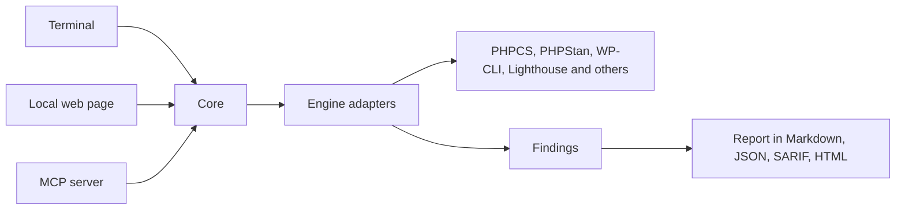

# Architecture

This document describes the design. Nothing here is implemented yet, and details may change until the first release.

## Principles

1. **Orchestrate existing tools.** PHPCS, PHPStan, WP-CLI and the rest already do their jobs well. wp-shakedown runs them and merges what they say. It adds a check of its own only where no maintained tool exists.
2. **Stay outside WordPress.** The tool is a separate process. It installs nothing into the site it tests, and checks against an install are read-only.
3. **The report is the product.** Every result from every tool is turned into the same shape, so a person or an AI assistant can read one report and act on it.
4. **One core, three ways in.** The terminal, the local web page and the MCP server are thin layers over the same core.

## Overview

## Targets

| Target | How it is tested |
|---|---|
| Theme or plugin folder | Code checks that need no running WordPress |
| WordPress install, by path | Health checks through WP-CLI, read-only |
| Site, by URL | Checks from the outside, in a browser |

## Engines

Each external tool sits behind an adapter that knows how to run it and how to read its output.

| Area | Engines |
|---|---|
| PHP code | PHP_CodeSniffer with WordPress Coding Standards and PHPCompatibilityWP, PHPStan with the WordPress extension, PHP Parallel Lint |
| JS, CSS, JSON | `@wordpress/scripts` linters, JSON Schema validation of `theme.json` and `block.json` |
| Install health | WP-CLI: `core verify-checksums`, `plugin verify-checksums`, `doctor`, `site-health` |
| Vulnerabilities | WPVulnerability.net lookups by plugin, theme and core version |
| Site from outside | Playwright with axe-core, Lighthouse, a link checker |

Plugin Check and Theme Check need a running WordPress. How they fit without a sandbox is an open question, tracked with [ADR 0007](../adr/0007-defer-sandbox-wordpress.md).

## Findings

The tools disagree on output: custom JSON, checkstyle XML, JUnit, SARIF. Adapters convert all of it into one finding shape:

- a stable ID, so the same problem keeps the same ID between runs
- the engine and rule that produced it
- a severity and a category on shared scales
- a location: file and line, or URL and selector
- the message, a fix hint, and the command that re-runs just this check

The report is exported as Markdown, JSON, SARIF and HTML. See [ADR 0005](../adr/0005-normalized-finding-schema.md).

## The fix loop

The report is written to be acted on, usually by an AI assistant:

- Two runs can be compared: fixed, new, still open.
- A single finding can be re-checked without a full run.
- A baseline file silences a finding, and each entry states why.

## Local web page

`wp-shakedown ui` starts an HTTP server on `127.0.0.1` and opens a browser tab. The page picks a folder, starts a run, shows progress live over a WebSocket, and displays the report.

- The folder is chosen through the server, because a browser cannot hand an absolute path to another process.
- The server accepts requests only with a token it puts into the page, since it reads the disk and starts processes.

## PHP runtime

PHP tools need PHP. The user chooses at setup: a bundled runtime that needs nothing installed, or the PHP already on the machine. See [ADR 0006](../adr/0006-php-runtime-user-choice.md).

## Deferred

A disposable WordPress that the tool starts by itself is not part of the design for now. It may come as a separate module, together with the checks that depend on it: activation tests, a crawl of test content, live authorization probes. See [ADR 0007](../adr/0007-defer-sandbox-wordpress.md).
