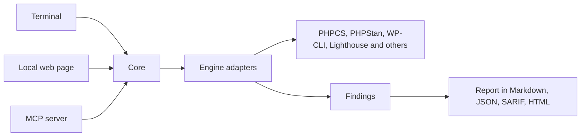

# Architecture

This document describes the design. Nothing here is implemented yet, and details may change until the first release.

## Principles

1. wp-shakedown runs existing tools and merges what they report. PHPCS, PHPStan and WP-CLI already do their jobs well, so it adds a check of its own only where no maintained tool exists.
2. It runs as a separate process, outside WordPress. It installs nothing into the site it tests, and it only reads from an install.
3. Adapters turn every result from every tool into the same shape, so a person or an AI assistant reads one report and acts on it.
4. The terminal, the local web page and the MCP server are thin layers over one core.

## Overview

## Targets

| Target | How it is tested |
|---|---|
| Theme or plugin folder | Code checks that need no running WordPress |
| WordPress folder | The same code checks on every theme and plugin inside it, plus health checks through WP-CLI. The tool only reads. |
| Site, by URL | Checks from the outside, in a browser. This is a separate module. |

A WordPress folder is tested the same way as a single theme or plugin, on your machine. The tool finds the themes and plugins in `wp-content` and runs the code checks on each, then adds the checks that only make sense for a whole install.

## Engines

Each external tool sits behind an adapter that knows how to run it and how to read its output.

| Area | Engines |
|---|---|
| PHP code | PHP_CodeSniffer with WordPress Coding Standards and PHPCompatibilityWP, PHPStan with the WordPress extension, PHP Parallel Lint |
| JS, CSS, JSON | `@wordpress/scripts` linters, JSON Schema validation of `theme.json` and `block.json` |
| Install health | WP-CLI: `core verify-checksums`, `plugin verify-checksums`, `doctor`, `site-health` |
| Vulnerabilities | WPVulnerability.net lookups by plugin, theme and core version |
| Site from outside | Playwright with axe-core, Lighthouse, a link checker |

Plugin Check and Theme Check need a running WordPress. [ADR 0007](../adr/0007-defer-sandbox-wordpress.md) tracks how they fit without a sandbox.

## Findings

The tools emit different formats: custom JSON, checkstyle XML, JUnit, SARIF. Adapters convert all of it into one finding shape:

- a stable ID, so the same problem keeps the same ID between runs
- the engine and rule that produced it
- a severity and a category on shared scales
- a location: file and line, or URL and selector
- the message, a fix hint, and the command that re-runs this one check

The tool exports the report as Markdown, JSON, SARIF and HTML. See [ADR 0005](../adr/0005-normalized-finding-schema.md).

## The fix loop

Most reports go to an AI assistant that then fixes the code. For that loop you can:

- compare two runs and see what is fixed, what is new and what is still open
- re-check a single finding without a full run
- silence a finding in a baseline file, where each entry states the reason

## Local web page

`wp-shakedown ui` starts an HTTP server on `127.0.0.1` and opens a browser tab. On the page you pick a folder, start a run, watch progress over a WebSocket and read the report.

- The server picks the folder, because a browser page cannot give another process an absolute path.
- The server reads the disk and starts processes, so it accepts a request only with the token it put into the page.

## PHP runtime

PHP tools need PHP. You choose at setup between a bundled runtime that needs nothing installed and the PHP already on your machine. See [ADR 0006](../adr/0006-php-runtime-user-choice.md).

## Deferred

The tool does not start a disposable WordPress by itself. That may come as a separate module, together with the checks that depend on it: activation tests, a crawl of test content, live authorization probes. See [ADR 0007](../adr/0007-defer-sandbox-wordpress.md).
